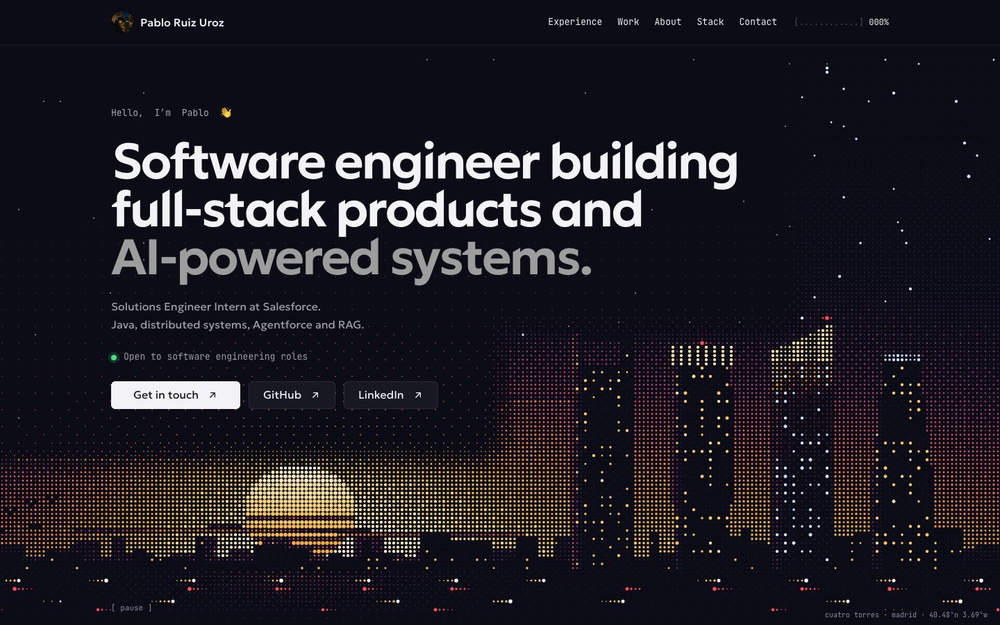

<a href="https://pruizz.github.io"></a>

# Pablo Ruiz Uroz

Software engineer building full-stack products and AI-powered systems, based in Madrid.

Solutions Engineer Intern at **Salesforce**, working with Java, distributed systems, Agentforce and RAG. Open to software engineering roles.

**[pruizz.github.io](https://pruizz.github.io)** · [LinkedIn](https://www.linkedin.com/in/pablo-ruiz-uroz/) · [lttpablo@2m5.es](mailto:lttpablo@2m5.es)

## What I'm working on

At Salesforce I build Agentforce demos and proofs of concept that combine AI agents, tool actions, automation and integrations with CRM and enterprise data. I design RAG workflows that ground agent responses in business data, with access controls and review of the generated output, and I turn customer requirements into solution architectures alongside sales and engineering teams.

## Selected projects

| Project | What it is | Stack |
| --- | --- | --- |
| **[Infracture Local](https://pruizz.github.io/work/infracture-local/)** | Bachelor's thesis. A distributed-systems experimentation platform: design a service topology, run it in isolated Docker environments and watch what breaks when a dependency slows down or fails. | Java · Spring Boot · React · PostgreSQL · Docker |
| **[Infracture Cloud](https://pruizz.github.io/work/infracture-cloud/)** | Bachelor's thesis. The cloud extension of Infracture: repeatable AWS environments, infrastructure as code, container orchestration and observability. | AWS · Kubernetes · CloudFormation · Docker · CI/CD |
| **[DSGram](https://pruizz.github.io/work/dsgram/)** | A social learning app for data structures, built in a team of four. I owned JWT authentication, the user APIs, the React flows, API docs and Docker. | Java · Spring Boot · React · TypeScript · MySQL |
| **[MiniShell](https://pruizz.github.io/work/minishell/)** | A shell written in C on POSIX APIs: concurrent pipelines, I/O redirection, job control and signal handling. | C · Linux · POSIX |

More on my [GitHub](https://github.com/pruizz).

## Stack

- **Languages:** Java, TypeScript, JavaScript, Python, C, Scala, Haskell, HTML, CSS
- **Backend & data:** Spring Boot, Node.js, Express, PostgreSQL, MySQL, MongoDB, Redis, RabbitMQ
- **Frontend:** React, Angular, Vite, Bootstrap
- **Cloud & DevOps:** AWS, CloudFormation, Kubernetes, Docker, GitHub Actions, Linux, Bash, Git
- **AI:** Agentforce, RAG, AI agents and tool actions
- **Testing:** JUnit, Mockito, Testcontainers, REST Assured, Playwright, Vitest, Postman

## Education

**Universidad Rey Juan Carlos** — Dual degree in Computer Engineering & Software Engineering. GPA **8.34 / 10**, with Highest Distinction in Distributed Systems, Web Application Development and Web Fundamentals.

Languages: Spanish (native), English (B2).

## About this site

The scenes are drawn live on a canvas as halftone dots: the Cuatro Torres of Madrid at sunset in the hero, and the Sierra de Guadarrama by moonlight over a reservoir at the end. Built with [Astro](https://astro.build) and React, published on GitHub Pages.

```bash
npm install && npm run dev
```
